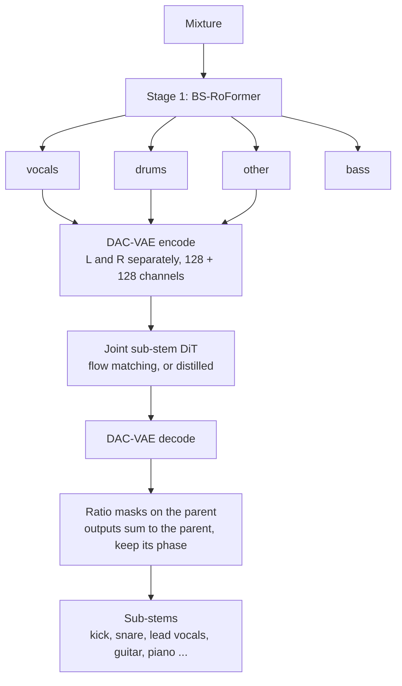

# MusSep
MusSep is a music source separation (MSS) system that combines established state-of-the-art architectures. It separates the conventional vocals, drums, bass and other stems, and extends separation to a second, hierarchical level.

Second-level separation splits the umbrella stems "vocals", "drums" and "other" into their sub-stems, such as kick, snare, lead vocals, backing vocals, piano, electric guitar and acoustic guitar.

The project was motivated by the [MDX23 Challenge](https://d3qvx1ggyg4lu1.cloudfront.net/challenges/sound-demixing-challenge-2023/problems/music-demixing-track-mdx-23#timeline).

## Results

| Stage | Test set | Metric | Training data | Average SDR |
|---|---|---|---|---|
| 1: primary stems (BS-RoFormer) | MUSDB18-HQ test, all 50 songs | BSSEval v4 via `museval`: median over 1-second frames, then median over songs | MUSDB18-HQ only | **9.8 dB** |

This matches the 9.80 dB average reported in the BS-RoFormer paper for its model trained on MUSDB18-HQ alone. Sub-stem results (Stages 2-4) are not included in this table. The evaluation protocol, and the results this number may be compared with, are described in [docs/evaluation.md](docs/evaluation.md).

## Overview
Music source separation (MSS) isolates individual sound sources, or stems, from a mixed recording: typically vocals, drums, bass and the remaining instruments. Separated stems can then be analysed and processed individually.

Most architectures are designed and evaluated for the four-stem vocals, drums, bass and other (VDB) convention. Few extend separation to finer hierarchies, and those that do typically lose accuracy on the conventional stems. Most are also trained on a single dataset, which aggravates the long-tail problem: instruments that appear rarely in the training data are separated poorly.

MusSep addresses both. A dedicated model separates the four primary stems, and a second, generative stage splits them into sub-stems such as guitar and piano, trained across datasets (MoisesDB and Slakh2100).

## How it works

MusSep separates in two levels.

1. **Primary stems (Stage 1).** A Band-Split RoFormer turns the mixture into vocals, bass, drums and other. It is deterministic: complex masks on the STFT, as in the paper.
2. **Sub-stems (Stages 2-4).** A generative model splits vocals, drums and other into labelled sub-stems. It works in the latent space of Meta's DAC-VAE and generates every sub-stem of a parent at once, conditioned on the parent stem. It is trained with flow matching, then distilled for 1-4 step sampling.



How each stage is built is in [docs/architecture.md](docs/architecture.md); the datasets, the sub-stem taxonomy and the latent dataset are in [docs/data.md](docs/data.md).

## Installation

```bash
git clone https://github.com/AdvaithGS/MusSep.git && cd MusSep
./repository_init.sh            # .venv, requirements, tests; add --cpu for CPU-only PyTorch
# or: conda env create -f environment.yml && conda activate mussep
```

The DAC-VAE comes from `pip install git+https://github.com/facebookresearch/dacvae` (in `requirements.txt`); its weights download from the Hugging Face Hub on first use. It is not needed for Stage 1.

## Running it

```bash
# Before building latents: check the real VAE (attributes, reconstruction per stem, chunking, repeatability)
python -m scripts.check_vae --moisesdb /data/moisesdb --max-tracks 5

# Stage 1: one model per stem, as in the paper
python -m pipeline.train_base --musdb-root /data/musdb18hq --stems vocals --tier base --out runs/vocals

# Stage 2: freeze the taxonomy, encode latents, train the DiT
python -m scripts.preprocess_latents --moisesdb /data/moisesdb --slakh /data/slakh2100 \
    --taxonomy configs/taxonomy.yaml --out /data/latents --num-aug 1 --bleed-db -30 -15
python -m pipeline.train_generative --manifest /data/latents/manifest.json --tier base --out runs/stage2

# Stage 4: distil to 2-step sampling
python -m pipeline.train_distill --teacher runs/stage2/best.pt --manifest /data/latents/manifest.json --out runs/stage4

# Separate
python -m scripts.separate song.wav --out separated/ \
    --stage1 runs/vocals/best.pt runs/drums/best.pt runs/bass/best.pt --stage2 runs/stage4/last.pt
python -m scripts.separate drums.wav --out separated/ --stage2 runs/stage4/last.pt --input-is drums --stems kick,snare

# Benchmarks
python -m scripts.evaluate stage1 --musdb-root /data/musdb18hq --stage1 runs/*/best.pt --metric museval
python -m scripts.evaluate stage2 --moisesdb /data/moisesdb --stage2 runs/stage4/last.pt --manifest /data/latents/manifest.json
python -m scripts.evaluate cascade --moisesdb /data/moisesdb --stage2 runs/stage4/last.pt --manifest /data/latents/manifest.json \
    --stage1 runs/vocals/best.pt runs/drums/best.pt runs/bass/best.pt
```

- Every training script resumes from `<out>/last.pt`, keeps `best.pt` by validation score, and logs to `<out>/log.jsonl`.
- Model size comes from `--tier` (`debug`, `small`, `base`).
- Precision is bf16 where the GPU supports it natively, else fp16 with a gradient scaler. STFTs, losses and the VAE always run in fp32.

The order of the steps, and running them on rented or free GPUs, is in [docs/training.md](docs/training.md).

## Documentation

| Document | Contents |
|---|---|
| [docs/architecture.md](docs/architecture.md) | Stage 1 BS-RoFormer, the joint sub-stem DiT, flow matching, inference and consistency distillation |
| [docs/data.md](docs/data.md) | Datasets and their layouts, the sub-stem taxonomy and minimum-data rule, the held-out split, the latent dataset |
| [docs/training.md](docs/training.md) | The order of the steps, and running on rented or free GPUs |
| [docs/evaluation.md](docs/evaluation.md) | Benchmark protocols, the cascade evaluation, checking Stage 1 against the reference implementation |
| [docs/background.md](docs/background.md) | Background, and the models and tools considered |

## Directory structure

```
configs/    roformer_base.yaml · dit_latent.yaml · distillation.yaml · taxonomy.yaml
data/       musdb18.py (Stage 1 random mixing) · moisesdb18.py · slakh.py · taxonomy.py (classes, mapping, minimum-data rule)
            unified_dataset.py (Stage 2 latent crops) · dataset.py · mix_pipeline.py · transforms.py
models/     bs_roformer.py · band_split.py · roformer.py (community-compatible Stage 1)
            dac_vae.py (DAC-VAE wrapper, stereo, chunking) · dit.py (joint sub-stem DiT)
pipeline/   train_base.py · train_generative.py · train_distill.py · flow_matching.py · distillation.py · infer.py
scripts/    taxonomy_stats.py · preprocess_latents.py · check_vae.py · separate.py · evaluate.py
            benchmark.py · compare_reference.py
utils/      audio.py · loss.py · metrics.py · training.py · runtime.py · config.py
docs/       architecture.md · data.md · training.md · evaluation.md · background.md
tests/
```

## Tests

```bash
pytest -q tests
```

60 tests run on CPU in about a minute and a half, on synthetic data laid out like the real datasets, with tiny models and a toy linear VAE. They cover:
- shapes and the community state-dict layout,
- RoPE against the reference package,
- the paper-size parameter count,
- slot equivariance and padding isolation in the DiT,
- the flow-matching target and samplers,
- the minimum-data rule,
- one end-to-end run through every script: freeze, encode, all three trainings with resume, separation and both evaluations.

They check the plumbing, not separation quality.

## Future Expansion
A possible extension is the [AudioX](https://github.com/ZeyueT/AudioX/) architecture, a Diffusion Transformer (DiT) that generates audio, including music, from multimodal and masked inputs. Described by its authors as an "anything-to-audio" model, it generates general audio and music under natural-language control and accepts text, video, image, music and audio as inputs. Its key innovation is a multimodal masked training strategy: masking inputs across modalities forces the model to learn robust, unified cross-modal representations.
