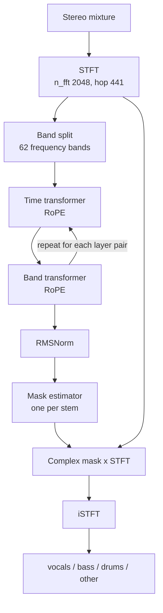
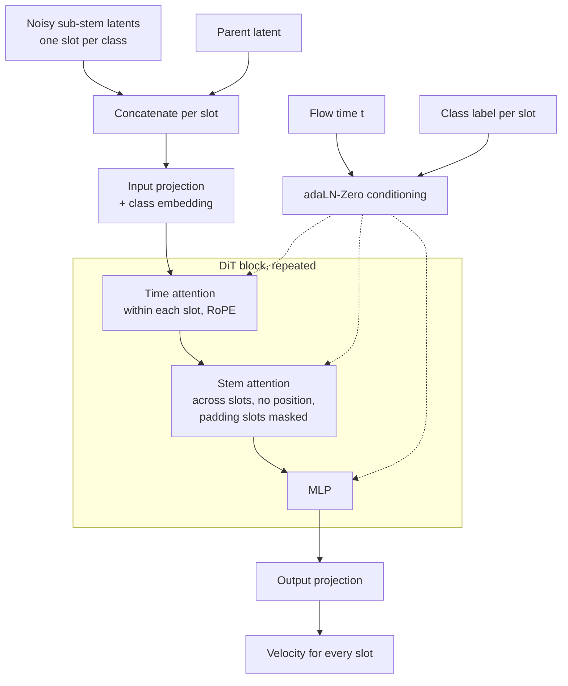
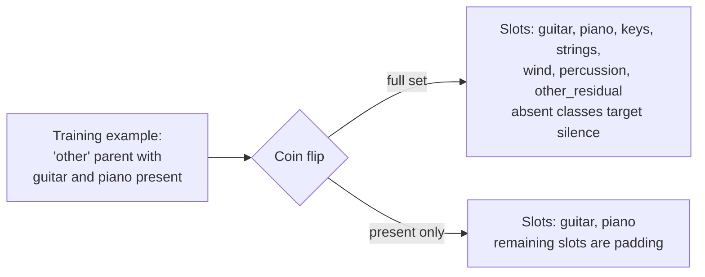
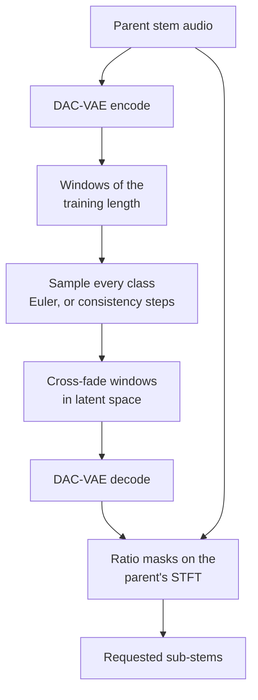
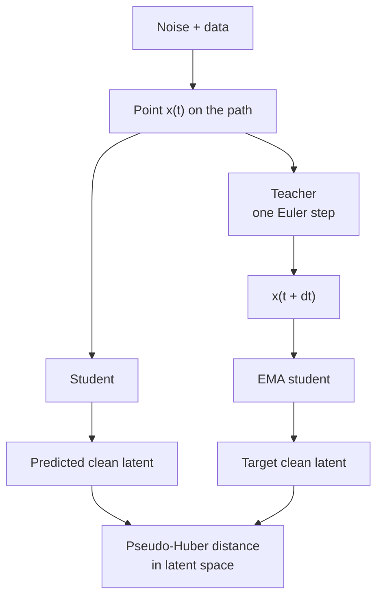

# Architecture

MusSep separates in two levels: a deterministic Band-Split RoFormer for the four primary stems (Stage 1), and a generative model in the DAC-VAE latent space for the sub-stems (Stages 2-4). The data side of Stage 2 (taxonomy, latents) is in [data.md](data.md).

- [Stage 1: BS-RoFormer](#stage-1-bs-roformer-modelsbs_roformerpy)
- [Stage 3: joint sub-stem DiT](#stage-3-joint-sub-stem-dit-modelsditpy-pipelineflow_matchingpy)
- [Stage 4: consistency distillation](#stage-4-consistency-distillation-pipelinedistillationpy)

## Stage 1: BS-RoFormer (`models/bs_roformer.py`)

- The module layout and state-dict keys are those of the community implementation (lucidrains / ZFTurbo), so public BS-RoFormer checkpoints load with `load_community_state_dict` (or `--stage1 model.ckpt --stage1-config model.yaml`). The tests check every key name and shape, and check our rotary embedding against `rotary-embedding-torch`.
- 62 frequency bands, a time transformer and a band transformer per layer, RoPE on both axes, one mask head per stem.
- Training (`configs/roformer_base.yaml`) follows the paper: random-mix augmentation (each stem from an independent song, ±3 dB gain, 10% silent stems, −50 dB loudness gate), waveform L1 + multi-resolution complex STFT L1 (windows 4096-256, hop 147), AdamW 5e-4 ×0.9 every 40k steps, EMA 0.999, 8-second excerpts, inference in 8-second windows with a 4-second hop. Two additions not in the paper: gradient-norm clipping at 1.0 (a guard against loss spikes; with Adam it mostly just down-weights outlier steps), and an EMA warmup (see below).
- Tier `base` (dim 384, 6 layer pairs, 8 heads of 48) has 72.2M parameters for one stereo stem, the paper's model size.

## Stage 2: taxonomy and latents

See [data.md](data.md#stage-2-taxonomy-and-latents).

## Stage 3: joint sub-stem DiT (`models/dit.py`, `pipeline/flow_matching.py`)

- Tokens sit on a (stem slot × time) grid. Each block attends along time within a slot (RoPE) and across slots at each time step. Slots have no position and are told apart only by their class embedding, so the model is equivariant to slot order (tested). Padding slots are masked out of attention and the loss.
- The parent latent is concatenated to every slot's input. The class embedding and flow time drive adaLN-Zero modulation.
- OT conditional flow matching (t = 0 noise, t = 1 data) with a per-slot validity mask, and 10% label dropout for classifier-free guidance.
- **Absent classes ("hybrid").** For each example a coin decides between two layouts. Either every class of the parent is listed, and absent ones must generate the latent of silence, or only the present classes are listed. So at inference you can ask for the whole set, or just `--stems guitar,piano`.

- Inference: Euler integration (50 steps by default), windows of the training length cross-faded in latent space, decoding, then a ratio-mask projection onto the parent's STFT. The outputs then sum to the parent stem and keep its phase; generated audio is only used as a magnitude guide. The projection is on by default. It needs every class, so a request for one stem (`--stems guitar`) still generates the whole set in one pass and returns only the guitar; `--no-project` generates only the requested slots, faster but without those guarantees.

- Label dropout stays on in training even though guidance is off by default (scale 1.0), so classifier-free guidance remains available. The distilled student is trained without it; guidance can instead be baked in through `teacher_cfg_scale`.
- EMA weights are what is evaluated and shipped. The decay ramps up as `min(decay, (1 + n) / (10 + n))`, reaching 0.999 after about 9k steps and 0.9999 after about 90k, so short runs are not judged on an average dominated by the initialisation.

## Stage 4: consistency distillation (`pipeline/distillation.py`)

The student starts from the teacher's weights. It learns to map two points on the teacher's ODE trajectory, one Euler step apart, to the same clean latent. The distance is Pseudo-Huber in latent space, and the target comes from an EMA copy of the student. This takes sampling from 50 steps to 1-4. Validation reports the latent distance between the student's few-step samples and the teacher's 50-step samples from the same noise.
