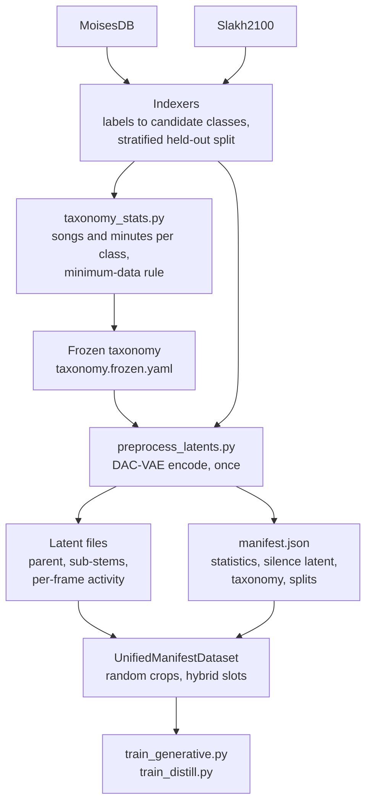
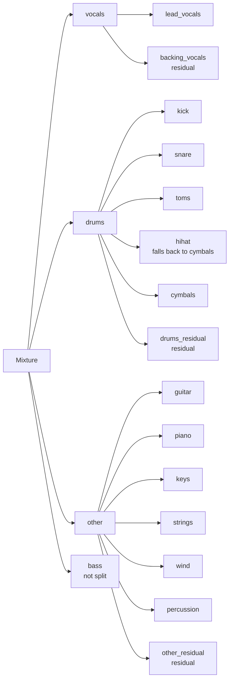
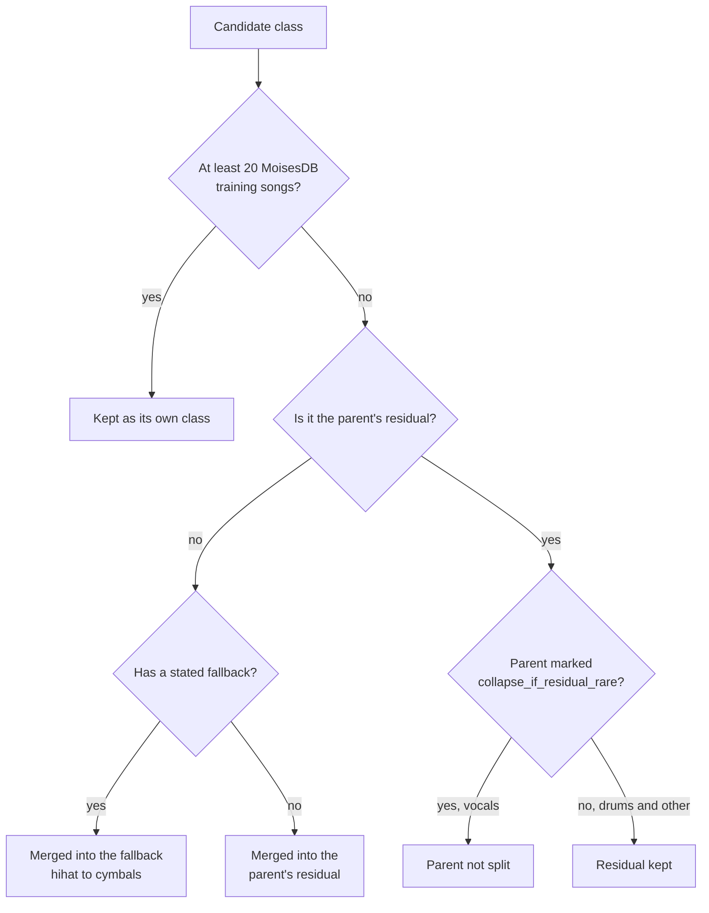

# Data

- [Datasets](#datasets)
- [Stage 2: taxonomy and latents](#stage-2-taxonomy-and-latents)
- [MoisesDB](#moisesdb)

From raw multitracks to what the Stage 2 trainer reads:



## Datasets

| Dataset | Used for | Layout expected |
|---|---|---|
| [MUSDB18-HQ](https://sigsep.github.io/datasets/musdb.html) | Stage 1 | `<root>/{train,test}/<song>/{mixture,vocals,bass,drums,other}.wav`; the official 14-song validation split is built in |
| [MoisesDB](https://music.ai/research/) | Stages 2-4 | `<root>/<provider>/<track id>/data.json` and `<stem>/<file id>.<ext>`, as distributed; 10% of songs held out, stratified: every class that can pass the 20-song rule gets up to 2 held-out songs, never so many that its training count drops below 20 |
| [Slakh2100](http://www.slakh.com/) | Stages 2-4, "other" only; weighted to a third of the "other" examples (vocals and drums examples are all MoisesDB) | `<root>/{train,validation,test}/TrackXXXXX/metadata.yaml` and `stems/Sxx.flac` |

## Stage 2: taxonomy and latents

Three parents are split; bass is not. The candidate classes live in `configs/taxonomy.yaml`:

| Parent | Candidate classes |
|---|---|
| vocals | lead_vocals, backing_vocals (the residual: every vocal that is not the lead) |
| drums | kick, snare, toms, hihat (falls back to cymbals), cymbals, drums_residual |
| other | guitar, piano, keys, strings, wind, percussion, other_residual |



MoisesDB labels map to classes by stem name and track type. For example, overheads, full-kit recordings and drum machines go to `drums_residual`, and the click track is excluded. Slakh2100 maps by General MIDI program and only supervises "other", since its drums are one stem.

**Minimum-data rule.** Classes are not frozen by hand. `scripts/taxonomy_stats.py` prints songs and minutes per class, per dataset. Any class with fewer than `min_songs` (default 20) **MoisesDB training** songs is merged: into its stated fallback (hi-hat → cymbals), otherwise into its parent's residual. Slakh does not count towards the threshold, so a class cannot survive on synthetic data alone. In vocals, backing vocals is the residual: choir, vocoder, beatbox and any unmapped vocal label land there. A residual is never merged away; if backing vocals still has fewer than 20 songs, vocals is not split at all, because a lead/backing split trained on so few songs would mostly learn to output silence in the second slot. (A rare residual does not stop drums or other from being split.) The frozen result, with the printed report as its header, is what preprocessing and the model use.



```bash
python -m scripts.taxonomy_stats --moisesdb /data/moisesdb --slakh /data/slakh2100 --freeze configs/taxonomy.frozen.yaml
```

**Latents** (`scripts/preprocess_latents.py`). Each sub-stem and each parent is encoded once with the frozen DAC-VAE, so the VAE never runs in training.
- Encoding uses the posterior mean, so a dataset encodes the same way twice.
- The VAE is mono: left and right are encoded separately and stored side by side (`[L, R]`, 2 × latent width channels).
- Presence is decided per latent frame (the RMS of each hop against −60 dBFS), not per song. A class is stored if it is active for at least a second, and the loader decides per crop whether it is present (active in ≥5% of the crop's frames). A guitar that plays only in the chorus is absent in verse crops: it is left out of the "present classes" layout there, and in the full-set layout its slot is trained on that silent stretch.
- Optional extra copies with a random gain per class, and an optional conditioning latent with the other stems mixed in at −30 to −15 dB, to imitate imperfect Stage 1 output.
- The manifest records latent statistics, the latent of silence, the frozen taxonomy and the split of every song.
- Size: float16 latents take `2 bytes × channels × frame rate` per second per stem. At 256 channels and 25 frames/s (the published DAC-VAE figures; the code reads the real values from the model) that is about 3.8 MB per stem per 5-minute song.

## MoisesDB
MoisesDB is the [largest publicly available set](https://music.ai/blog/press/introducing-moisesdb-the-ultimate-multitrack-dataset-for-source-separation-beyond-4-stems/) of multitrack recordings for source separation beyond four stems. It comprises 240 previously unreleased songs by 47 artists across twelve high-level genres, 14 hours, 24 minutes and 46 seconds in total. The average song lasts 3 minutes 36 seconds, with a standard deviation of 66 seconds.
