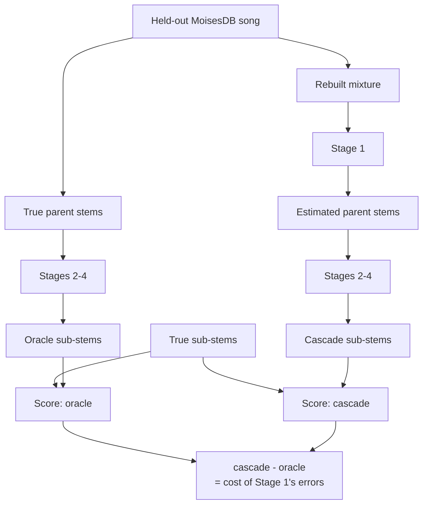

# Evaluation

- [Benchmarks](#benchmarks)
- [Checking Stage 1 against the reference implementation](#checking-stage-1-against-the-reference-implementation)

## Benchmarks

- **Stage 1 result.** MusSep's Stage 1 models, trained on MUSDB18-HQ alone, reach **9.8 dB** average SDR on the MUSDB18-HQ test set, measured with `scripts/evaluate.py stage1 --metric museval` on all 50 test songs. The BS-RoFormer paper reports 9.80 dB average SDR on the MUSDB18-HQ test set for its model trained on MUSDB18-HQ alone (vocals 10.66, bass 11.31, drums 9.49, other 7.73). A number is comparable with these only when it is:
  - `scripts/evaluate.py stage1 --metric museval` (BSSEval v4: median over 1-second frames, then median over the 50 test songs),
  - on the full test set,
  - for models trained on MUSDB18-HQ alone.

  The script says when a run does not meet these conditions.
- **Community checkpoints.** Nearly all published BS-RoFormer checkpoints used extra training data. Their scores belong in a separate row and must not be presented as MUSDB-only.
- **Stage 2** has no established benchmark. `evaluate.py stage2` gives the true parent stem to the generator for held-out MoisesDB songs and reports per class:
  - SDR and SI-SDR where the class is present,
  - the output level relative to the parent where it is absent (it should be silence).

  It measures Stage 2 alone.
- **The cascade.** `evaluate.py cascade` rebuilds each held-out song's mixture, runs Stage 1, splits the *estimated* parents and scores them against the same true sub-stems. It runs the oracle on the same excerpts too, so the "cascade − oracle" column is the cost of Stage 1's errors. That is the number a user gets. Stage 1's SDR on these MoisesDB songs is reported alongside, as a cross-dataset figure, not a benchmark.

## Checking Stage 1 against the reference implementation

`scripts/compare_reference.py` builds lucidrains' published `BS-RoFormer` package and our model with the same configuration, compares weight names and shapes, and, if they match, the outputs with identical weights. It is not part of the test suite and has not been run here; install the release closest to the checkpoints you plan to load (`pip install BS-RoFormer==0.4.1`, for example) and run `python -m scripts.compare_reference`.
