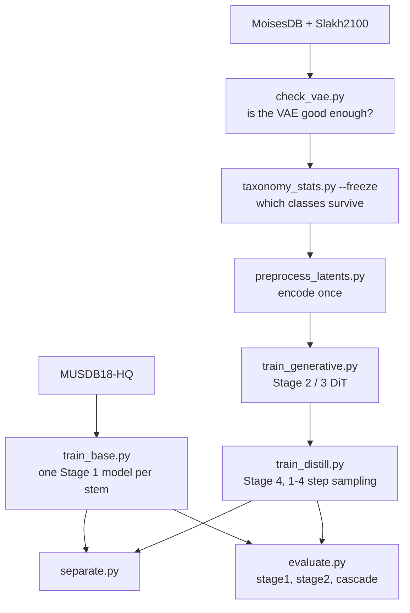
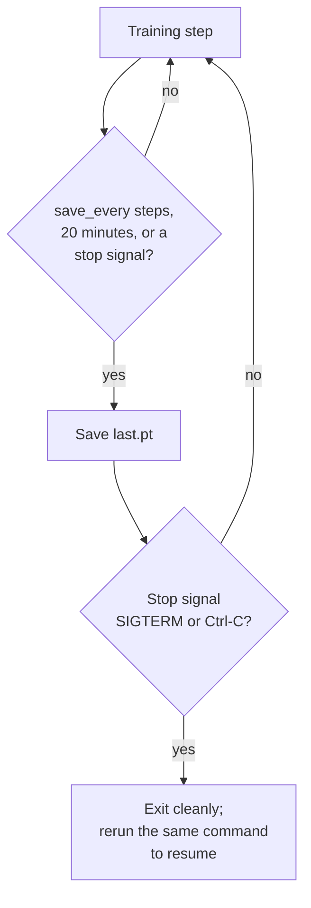
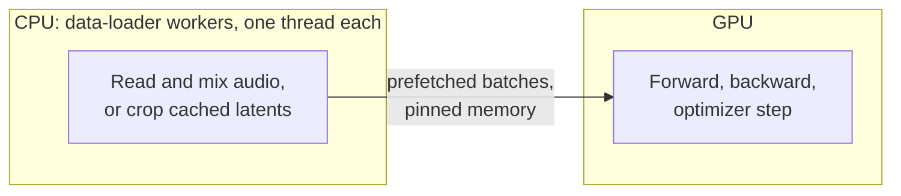

# Training

The commands are in the [README](../README.md#running-it). They depend on each other in this order:

## Running on rented or free GPUs

Every stage runs on one GPU. The code is set up for low-cost, interruptible machines:

- **Measure before you pay.** `python -m scripts.benchmark stage1 --tiers small base --price-per-hour 0.45` finds the largest batch that fits for each tier. It reports seconds per step, peak memory, and the hours and cost of the config's full run. With `--musdb-root` (Stage 1) or `--manifest` (Stage 2) it also times the data loader at several worker counts and says whether the CPU keeps up with the GPU. A free Kaggle or Colab session is enough to run it.
- **Interruptions cost minutes.** Checkpoints are written every `save_every` steps and at least every `save_every_minutes` (20). SIGTERM or Ctrl-C finishes the current step, saves `last.pt` and exits. Spot instances, Colab and Kaggle send SIGTERM before they reclaim the machine. Rerunning the same command resumes.

- **CPU balance.**
  - Data-loader workers default to every available CPU but two (container limits respected).
  - Each worker runs a single intra-op thread, and the main process keeps only a few, so they don't oversubscribe the cores.
  - Batches are prefetched (`prefetch_factor`) into pinned memory.
  - Pre-encoding loads and resamples the next songs in worker processes while the GPU encodes the current one, and skips songs whose latents already exist.
  - Resampling in the VAE wrapper and the final projection run on the GPU.

- **Stage 2 data in RAM.** `cache_in_memory: auto` loads every latent file into memory when they fit in half of it. Rented machines often keep data on network disks, where reading thousands of small files a minute starves the GPU.
- **Speed switches.** TF32 is on (`tf32: true`). `torch.compile` is off by default (`compile: true` or `--compile`); measure it with the benchmark first, since it costs compile time at start-up and the gain varies.
- **Disk.** Copy datasets to the machine's local disk before training, not a mounted network volume. Stage 1 reads random excerpts constantly.
